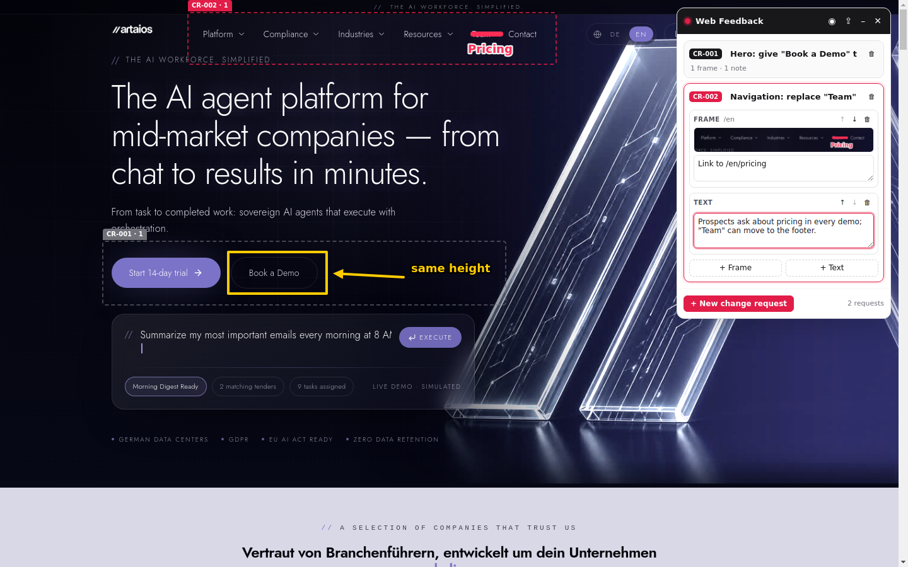
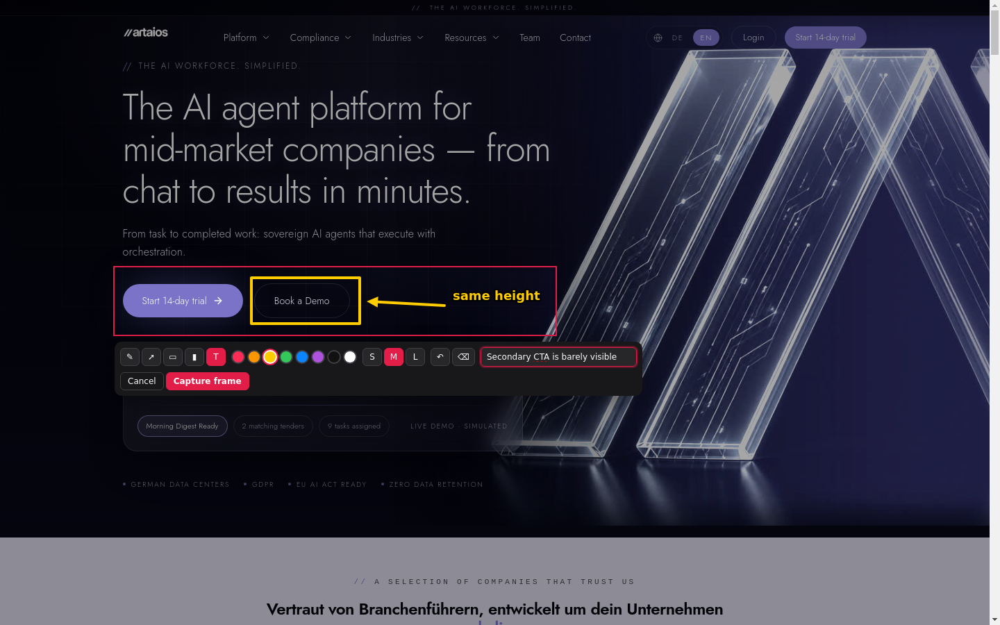
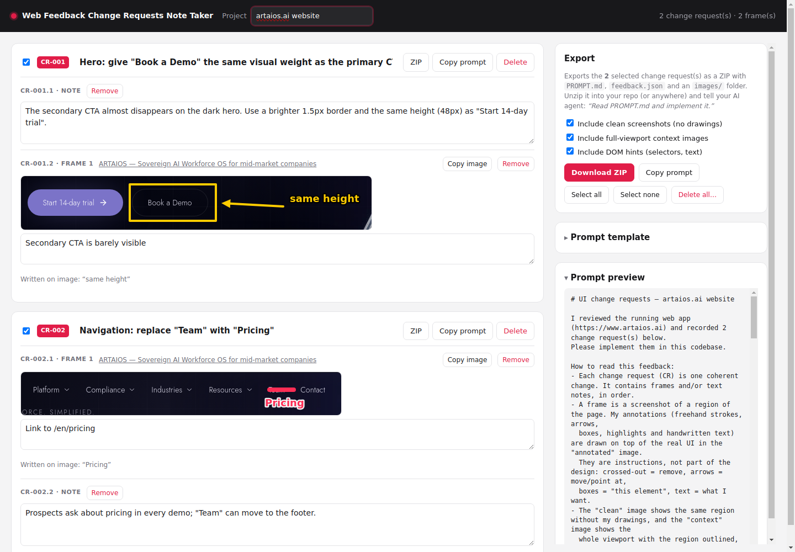

<div align="center">


# Web Feedback Change Requests Note Taker

**Draw on any website, collect annotated screenshots into change requests, and export them as a prompt your AI coding agent can implement.**

[](https://github.com/lLostincode/ai_ui_review/actions/workflows/test.yml)


[](LICENSE)



</div>

---

Describing UI changes to an AI agent in text alone takes a lot of words: *"the second button in the hero, no, the outlined one, make it the same height…"*.
A screenshot with an arrow on it says the same thing at once.

This extension adds a drawing layer on top of any page you can open in Chrome, such as `localhost:3000`, staging or production.
While you click through your app, you mark what should change. At the end you have one bundle (Markdown plus images) that you can give to Claude Code, Cursor, Copilot or any other agent.

> [!NOTE]
> No AI runs inside the extension. It records what you draw and write, and nothing leaves your machine until you export it.

## Contents

- [Features](#features)
- [Install](#install)
- [Quick start](#quick-start)
- [Keyboard shortcuts](#keyboard-shortcuts)
- [What the export looks like](#what-the-export-looks-like)
- [Using the export with an AI agent](#using-the-export-with-an-ai-agent)
- [Privacy](#privacy)
- [How it works](#how-it-works)
- [Development](#development)
- [Known limitations](#known-limitations)
- [Contributing](#contributing) · [License](#license)

## Features

- **Works on any site.** Use it on localhost, staging, production or a competitor's site. Toggle it with one click or `Alt+Shift+F`.
- **Change requests (CRs).** Each CR is a group of related feedback with a title and any number of items, which you can reorder.
  - **+ Frame**: select a region of the page, draw on it with a pen, arrows, boxes, a highlighter or text, and capture it.
  - **+ Text**: a plain written note.
- **Annotations stay on the page.** When you come back to a page, your saved frames are drawn back onto it with their labels (`CR-001 · 1`). You can show or hide them at any time.
- **Context for the AI.** Each frame stores:
  - an annotated crop
  - a clean crop (without drawings)
  - a full-viewport context image
  - **DOM hints** (CSS selectors, test ids, aria labels, link targets and visible text of the elements in the region), so the agent can find the right component in your code
- **Export:** a ZIP with `PROMPT.md`, `feedback.json` and `images/`, for all CRs or a single one. You can also copy the prompt or a single image to the clipboard.
- **Editable prompt template** with placeholders, so the instructions can match your team's workflow.
- **Small:** plain JavaScript, no build step, no runtime dependencies, and all UI isolated in a shadow DOM so it doesn't conflict with the page's styles.

## Install

The extension is not on the Chrome Web Store yet. Load it unpacked:

1. Download this repository (**Code → Download ZIP**, then unzip it) or clone it:
   ```sh
   git clone https://github.com/lLostincode/ai_ui_review.git
   ```
2. Open `chrome://extensions` and switch on **Developer mode** (top right).
3. Click **Load unpacked** and select the folder that contains `manifest.json`.
4. Pin **Web Feedback CR** from the puzzle-piece menu so the icon is always visible.

It also works in other Chromium browsers (Edge, Brave, Arc, Opera) through the same "load unpacked" flow.

> [!TIP]
> To annotate local HTML files (`file://…`), open the extension's **Details** page and enable **Allow access to file URLs**.

## Quick start

### 1. Turn on the overlay

Open your app and click the extension icon, or press <kbd>Alt</kbd>+<kbd>Shift</kbd>+<kbd>F</kbd>. The **Web Feedback** panel appears in the top-right corner and the icon shows a red `ON` badge.
The overlay stays on in that tab across reloads and navigation until you turn it off.

### 2. Create a change request

Click **+ New change request** and give it a title that describes the change, for example *"Navigation: replace Team with Pricing"*.
Keep each CR to one coherent change. This lets you export CRs one at a time and give each one to an agent as a separate task.

### 3. Add frames and notes

Click **+ Frame** (or press <kbd>Alt</kbd>+<kbd>Shift</kbd>+<kbd>S</kbd>) and drag over the part of the page you want to discuss. Then draw on it:



| Tool | Key | Use it for |
| --- | --- | --- |
| ✎ Pen | <kbd>P</kbd> | Crossing things out, circling, rough sketches of new UI |
| ➚ Arrow | <kbd>A</kbd> | "Move this here" or "this one" |
| ▭ Box | <kbd>B</kbd> | Marking an element |
| ▮ Highlighter | <kbd>H</kbd> | Marking a whole area without hiding it |
| T Text | <kbd>T</kbd> | Short instructions written onto the screenshot |

Pick a color and a stroke size (S/M/L), optionally add a comment, and click **Capture frame** (or press <kbd>Enter</kbd> in the comment field).

Use **+ Text** for anything that is easier to write than to draw. A CR can contain any mix of frames and notes, and frames can come from different pages.

### 4. Review and export

Open the review page with the **⇪** button in the panel, or by right-clicking the extension icon → *Review & export change requests*.



Here you can edit titles and notes, choose which CRs to include, and preview the generated prompt. Then click **Download ZIP**.
Each CR also has its own **ZIP** and **Copy prompt** buttons.

## Keyboard shortcuts

| Shortcut | Action |
| --- | --- |
| <kbd>Alt</kbd>+<kbd>Shift</kbd>+<kbd>F</kbd> | Toggle the overlay in the current tab |
| <kbd>Alt</kbd>+<kbd>Shift</kbd>+<kbd>S</kbd> | Add a frame to the active change request |
| <kbd>Enter</kbd> (while selecting) | Use the whole viewport as the frame |
| <kbd>Esc</kbd> | Cancel the selection or annotation |
| <kbd>P</kbd> <kbd>A</kbd> <kbd>B</kbd> <kbd>H</kbd> <kbd>T</kbd> | Pen, arrow, box, highlighter, text |
| <kbd>Ctrl</kbd>/<kbd>⌘</kbd>+<kbd>Z</kbd> | Undo the last stroke |
| <kbd>Ctrl</kbd>/<kbd>⌘</kbd>+<kbd>Enter</kbd> | Capture the frame |

You can change the two global shortcuts at `chrome://extensions/shortcuts`.

## What the export looks like

```
artaiosai-website-2026-10-30-1205/
├── PROMPT.md          ← give this to your agent
├── feedback.json      ← the same content as structured data
└── images/
    ├── CR-001-1-annotated.png   ← your drawings on top of the real UI
    ├── CR-001-1-clean.png       ← the same region without drawings
    ├── CR-001-1-context.jpg     ← the whole viewport, region outlined
    └── …
```

`PROMPT.md` starts with instructions that explain to the agent how to read the annotations. It then lists every CR in order:

```markdown
## CR-001: Hero: give "Book a Demo" the same visual weight as the primary CTA

### CR-001.1 Note

> The secondary CTA almost disappears on the dark hero. Use a brighter 1.5px border
> and the same height (48px) as "Start 14-day trial".

### CR-001.2 Frame on `/en`


> Secondary CTA is barely visible

Text written on the screenshot:
- "same height"

- Page: [ARTAIOS — Sovereign AI Workforce OS …](https://www.artaios.ai/en)
- Region: 635×97 CSS px at x=165, y=385 (document), viewport 1440×900 @1x
- DOM hints:
  - Element at region centre: `… > a.border-border.text-secondary-foreground` — "Book a Demo"
  - `… > a.bg-primary.text-primary-foreground` — "Start 14-day trial"
```

👉 See the complete example export in [`docs/example/`](docs/example/PROMPT.md). It was recorded on [artaios.ai](https://www.artaios.ai).

### Customizing the prompt

On the review page, open **Prompt template** to change the instructions. The template supports these placeholders:

| Placeholder | Replaced with |
| --- | --- |
| `{{requests}}` | All selected change requests (they are appended if the placeholder is missing) |
| `{{count}}` | The number of selected change requests |
| `{{origins}}` | The site(s) the frames were captured on |
| `{{project}}` / `{{projectSuffix}}` | The project name / ` — <project name>` |
| `{{date}}` | The export date (`YYYY-MM-DD`) |

## Using the export with an AI agent

Unzip the export, ideally into a git-ignored folder inside your repository (for example `.feedback/`), then:

| Agent | Example |
| --- | --- |
| **Claude Code** | `claude "Read .feedback/<export>/PROMPT.md and the images it references, then implement all change requests."` |
| **Cursor / Windsurf** | Add `PROMPT.md` and the `images/` folder to the chat context and ask the agent to implement it. |
| **GitHub Copilot (agent mode)** | Attach `PROMPT.md` and the images, then ask it to implement the CRs. |
| **Chat UIs (claude.ai, ChatGPT, …)** | Paste the prompt from **Copy prompt** and drag in the images. **Copy image** puts single frames on the clipboard. |

Tips for good results:

- **One CR, one concern.** Small CRs give focused changes and diffs that are easy to review. Use the per-CR **ZIP** button to give each one to a separate agent run or branch.
- **Write the intent, draw the location.** The drawing shows *where* the change goes. A short note or caption says *what* you want and *why*.
- **Use test ids.** If your app uses `data-testid`, the DOM hints include them, and agents find the code much faster.

## Privacy

Everything stays in your browser:

- Change requests and screenshots are stored in `chrome.storage.local` on your machine.
- The extension makes **no network requests**, has no analytics and needs no account.
- Data leaves the browser only when you export a ZIP or copy something to the clipboard.

See [PRIVACY.md](PRIVACY.md) for details, including why each permission is needed.

## How it works

```
manifest.json            MV3 manifest
src/background.js        Service worker: toggling, re-injection after navigation, screenshots
src/content/overlay.js   Injected UI (shadow DOM): panel, region select, drawing, capture, on-page pins, DOM hints
src/review/              Review & export page
src/lib/prompt.js        State → PROMPT.md + image list + feedback.json (pure, unit-tested)
src/lib/zip.js           Dependency-free ZIP writer (pure, unit-tested)
src/lib/store.js         chrome.storage.local layout
```

- **Capture.** The overlay hides itself and asks the service worker to call `chrome.tabs.captureVisibleTab`. The content script then crops the selected region and draws your annotations on top. Annotations are vector strokes in CSS pixels, so they come out sharp at any device pixel ratio.
- **Storage.** `wfcr:state` holds the change requests, and each image is a separate `wfcr:img:<id>` entry, so the state stays small. Several tabs can edit the same set of CRs at once: every write re-reads the latest state first.
- **Persistence across navigation.** The service worker remembers which tabs have the overlay on (`chrome.storage.session`) and re-injects it after each page load. Changes to the URL in single-page apps are detected in the page.

## Development

Requirements: Chrome or another Chromium browser, and Node.js ≥ 20 (only for tests and scripts).

```sh
npm test          # unit tests: prompt generation and ZIP writer
npm run icons     # regenerate icons/*.png from tools/make-icons.mjs
npm run package   # zip the extension into dist/ for the Chrome Web Store
```

After changing code, click ↻ on the extension card in `chrome://extensions`. Then turn the overlay off and on again in tabs that are already open.

## Known limitations

- Only the **visible viewport** can be captured, not the full scrolling page. Scroll first, then add another frame.
- Regions are stored in document coordinates. A frame drawn on a `position: fixed`/sticky element (such as a sticky header) can appear in the wrong place after you scroll.
- Chrome blocks extensions on `chrome://` pages, the Chrome Web Store and the built-in PDF viewer. The icon shows `ERR` there.
- Screenshots are stored as PNG/JPEG data in extension storage. Delete exported CRs from time to time (review page → **Delete all…**) to keep it small.

## Contributing

Issues and pull requests are welcome. See [CONTRIBUTING.md](CONTRIBUTING.md).

## License

[MIT](LICENSE)
