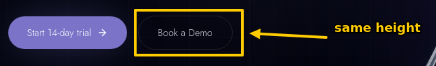
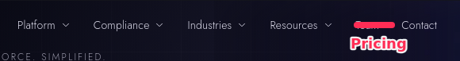

# UI change requests — artaios.ai website

I reviewed the running web app (https://www.artaios.ai) and recorded 2 change request(s) below.
Please implement them in this codebase.

How to read this feedback:
- Each change request (CR) is one coherent change. It contains frames and/or text notes, in order.
- A frame is a screenshot of a region of the page. My annotations (freehand strokes, arrows,
  boxes, highlights and handwritten text) are drawn on top of the real UI in the "annotated" image.
  They are instructions, not part of the design: crossed-out = remove, arrows = move/point at,
  boxes = "this element", text = what I want.
- The "clean" image shows the same region without my drawings, and the "context" image shows the
  whole viewport with the region outlined, so you can see where it is on the page.
- Each frame lists the full URL it was captured on. Its path, query and hash tell you which route
  (and which page state) to look at.
- "DOM hints" list selectors, test ids and visible text of elements inside the region. Use them to
  find the responsible components in the code (search for the text, test ids or class names).

How to work:
1. For each CR, locate the relevant code, then make the smallest change that satisfies it.
   Match the existing design system, components and styling conventions.
2. If a CR is ambiguous, make a reasonable choice and state the assumption.
3. When done, list per CR what you changed (files) and anything you could not resolve.

## CR-001: Hero: give "Book a Demo" the same visual weight as the primary CTA

### CR-001.1 Note

> The secondary CTA almost disappears on the dark hero. Use a brighter 1.5px border and the same height (48px) as "Start 14-day trial".

### CR-001.2 Frame on `/en`

> Secondary CTA is barely visible

Text written on the screenshot:
- "same height"

- URL: `https://www.artaios.ai/en`
- Page title: ARTAIOS — Sovereign AI Workforce OS for mid-market companies
- Region: 635×97 CSS px at x=165, y=385 (document), viewport 1440×900 @1x
- Without annotations: `images/CR-001-1-clean.png`
- Full viewport for context: `images/CR-001-1-context.jpg`
- DOM hints:
  - Region container: `div#top > div.relative.mx-auto:nth-of-type(3)` — "// THE AI WORKFORCE. SIMPLIFIED. The AI agent platform for mid-market companies — from chat to results in minutes. Fr…"
  - Element at region centre: `div#top > div.relative.mx-auto:nth-of-type(3) > div.mt-8.flex:nth-of-type(2) > span.inline-block:nth-of-type(2) > a.border-border.text-secondary-foreground` — href `https://example.com/book-a-demo` — "Book a Demo"
  - `div#top > div.relative.mx-auto:nth-of-type(3) > div.mt-8.flex:nth-of-type(2) > span.inline-block:nth-of-type(1) > a.bg-primary.text-primary-foreground` — href `https://example.com/checkout` — "Start 14-day trial"

---

## CR-002: Navigation: replace "Team" with "Pricing"

### CR-002.1 Frame on `/en`

> Link to /en/pricing

Text written on the screenshot:
- "Pricing"

- URL: `https://www.artaios.ai/en`
- Page title: ARTAIOS — Sovereign AI Workforce OS for mid-market companies
- Region: 580×78 CSS px at x=300, y=22 (document), viewport 1440×900 @1x
- Without annotations: `images/CR-002-1-clean.png`
- Full viewport for context: `images/CR-002-1-context.jpg`
- DOM hints:
  - Region container: `body > main.bg-background.min-h-screen` — "// THE AI WORKFORCE. SIMPLIFIED. Platform Compliance Industries Resources Team Contact DE EN Login Start 14-day trial…"
  - Element at region centre: `main.bg-background.min-h-screen > header.fixed.inset-x-0 > nav.mx-auto.flex > div.hidden.items-center:nth-of-type(1) > button.flex.items-center:nth-of-type(3)` — "Industries"
  - `main.bg-background.min-h-screen > header.fixed.inset-x-0 > nav.mx-auto.flex > div.hidden.items-center:nth-of-type(1) > button.flex.items-center:nth-of-type(1)` — "Platform"
  - `main.bg-background.min-h-screen > header.fixed.inset-x-0 > nav.mx-auto.flex > div.hidden.items-center:nth-of-type(1) > button.flex.items-center:nth-of-type(2)` — "Compliance"
  - `main.bg-background.min-h-screen > header.fixed.inset-x-0 > nav.mx-auto.flex > div.hidden.items-center:nth-of-type(1) > button.flex.items-center:nth-of-type(4)` — "Resources"
  - `main.bg-background.min-h-screen > header.fixed.inset-x-0 > nav.mx-auto.flex > div.hidden.items-center:nth-of-type(1) > a.text-secondary-foreground.hover\:text-foreground:nth-of-type(1)` — href `/en/team` — "Team"
  - `main.bg-background.min-h-screen > header.fixed.inset-x-0 > nav.mx-auto.flex > div.hidden.items-center:nth-of-type(1) > a.text-secondary-foreground.hover\:text-foreground:nth-of-type(2)` — href `/en/kontakt` — "Contact"

### CR-002.2 Note

> Prospects ask about pricing in every demo; "Team" can move to the footer.
